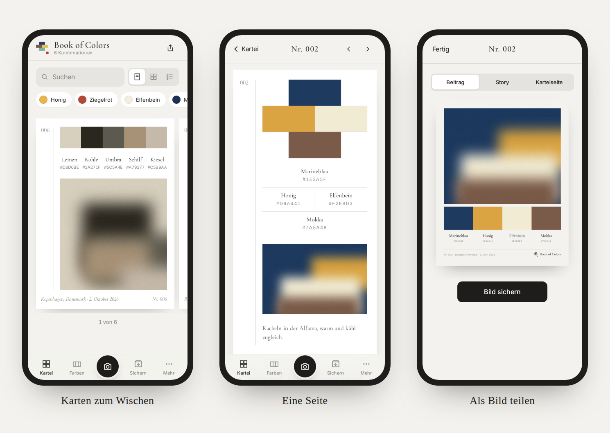
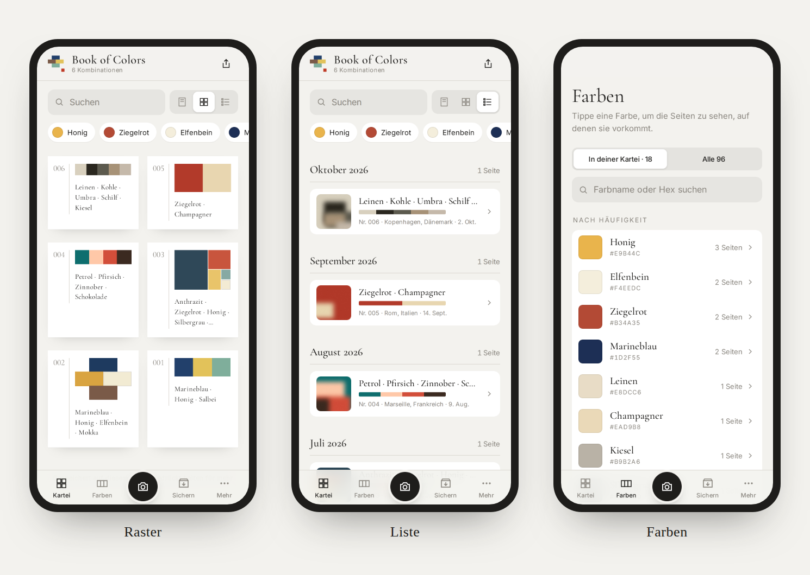
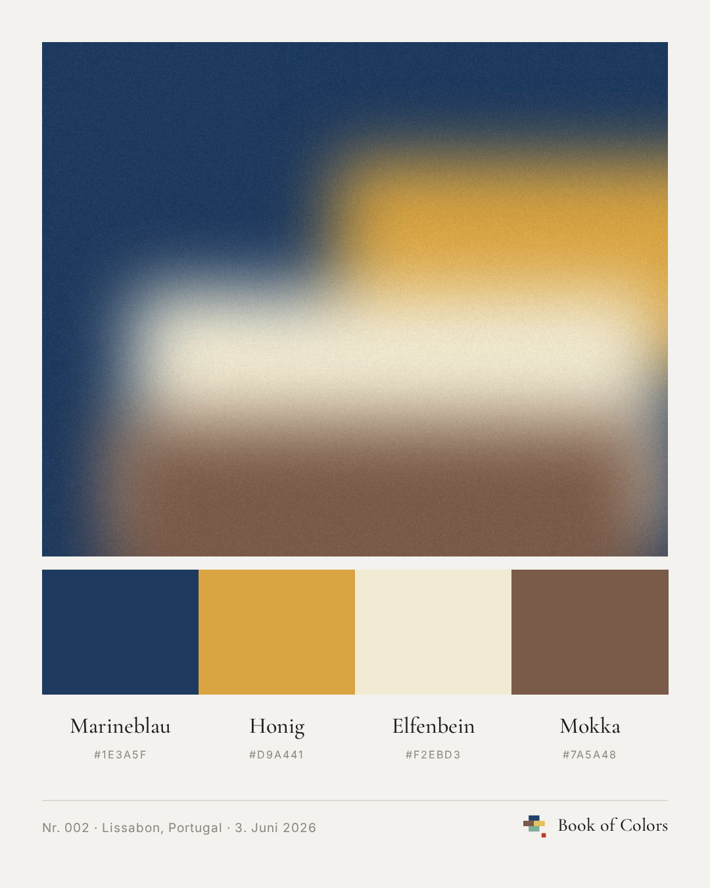

  

<h1 align="center">Book of Colors</h1>

  Farbkombinationen aus eigenen Fotos sammeln. 
  Eine Kartei aus Farben, Orten und Momenten.

  <a href="https://max.does.systems/utility/bookofcolors/"><b>App öffnen</b></a>
  &nbsp;·&nbsp;
  <a href="../../releases">Versionen</a>
  &nbsp;·&nbsp;
  <a href="CHANGELOG.md">Änderungen</a>

  

---

## Die Idee

Manche Farben bleiben hängen: das Blau eines Hafens am Abend, warme Kacheln in einer Altstadt, Leinen und Stein in einem stillen Raum. Book of Colors hält solche Momente fest. Du fotografierst, die App liest die prägenden Farben heraus und legt daraus eine nummerierte Seite an: Farbfelder, Farbnamen, Hex-Werte und dein Foto darunter. Seite für Seite wächst so eine eigene Farbkartei.

## So funktioniert es

1. **Fotografieren.** Im Live-Sucher folgt die Palette dem Kamerabild. Ein Tipp hält Foto, Ausschnitt und Farben fest. Oder du wählst ein Bild aus deiner Mediathek.
2. **Feinschliff.** Ausschnitt wählen, zwei bis fünf Farben, Anordnung als Reihe, Kreuz oder Feld. Farben gegen Vorschläge aus dem Foto tauschen oder mit der Lupe genau aufnehmen.
3. **Notieren.** Ort und Aufnahmezeit kommen aus dem Foto. Dazu ein paar eigene Worte, getippt oder diktiert.
4. **Sammeln und teilen.** Die Seite landet in deiner Kartei. Als gestaltetes Bild verschickst du sie per Nachricht oder als Story.

## Funktionen

**Kartei**
- Karten in Bildschirmgröße zum seitlichen Wischen, dazu Raster und Liste
- Suche nach Farbe, Ort, Nummer oder Notiz, Schnellfilter nach deinen häufigsten Farben
- Gedrückt halten öffnet Teilen, Notiz, Bearbeiten und Löschen

**Farben**
- Erkennung, die Kanten und große neutrale Flächen ausblendet und die prägenden Farben findet
- 96 deutsche Farbnamen, nach Farbfamilien geordnet und durchsuchbar
- Jede Farbe zeigt, auf welchen deiner Seiten sie vorkommt

**Ort und Zeit**
- Aufnahmezeit und Ort aus den Fotodaten, der Ortsname wird offline auf dem Gerät ermittelt
- Auf Wunsch der aktuelle Standort, mit einem Tipp auf der Karte zu sehen

**Teilen**
- Jede Seite als gestaltetes Bild: Beitrag (4:5), Story (9:16) oder Karteiseite
- Das eigene Farbprofil als Bild oder als Link, über den andere deine Kombinationen übernehmen können

  

<table>
  <tr>
    <td width="44%"></td>
    <td>
      <b>Ein geteiltes Bild</b>  
      Foto, Farbband, Namen und Hex-Werte, dazu Nummer, Ort und Datum. Gesetzt in Cormorant Garamond und Inter, auf warmem Papiergrund. Bereit für Nachrichten, Instagram oder den Ausdruck.
    </td>
  </tr>
</table>

## Installieren

Book of Colors läuft im Browser und lässt sich wie eine App auf den Home-Bildschirm legen. Nach dem ersten Öffnen funktioniert sie auch offline.

| Gerät | So geht's |
|---|---|
| **iPhone und iPad** | Link in Safari öffnen, Teilen → „Zum Home-Bildschirm“ |
| **Android** | Link in Chrome öffnen, Menü → „App installieren“ |
| **Mac** | Safari: Ablage → „Zum Dock hinzufügen“. Chrome: Installieren-Symbol in der Adressleiste. Bilder lassen sich ins Fenster ziehen oder mit ⌘V einfügen. |

## Deine Daten

- Seiten, Fotos und Notizen bleiben auf deinem Gerät, im Speicher des Browsers.
- Kein Konto, keine Cookies, kein Tracking, keine Anfragen an Dritte.
- Ortsnamen werden offline ermittelt; Koordinaten verlassen das Gerät nicht.
- Sicherungen legst du selbst als Datei ab: auf dem iPhone in iCloud Drive, auf Android in Google Drive. Die App erinnert dich, wenn neue Seiten noch nicht gesichert sind.
- Ein geteilter Profil-Link enthält nur Farben, keine Fotos, Orte oder Notizen.

## Über dieses Repository

Hier liegen nur die [Versionen](../../releases), der [CHANGELOG](CHANGELOG.md) und die Lizenz. Der Code ist nicht öffentlich.

## Rechtliches

- Anbieter: Maximilian Dahl, [Impressum](https://max.does.systems/impressum/), [Datenschutzerklärung](https://max.does.systems/datenschutz/)
- Nutzung nur im Browser unter der oben genannten Adresse; alle Rechte vorbehalten, siehe [LICENSE](LICENSE).
- Schriften: Cormorant Garamond und Inter, SIL Open Font License 1.1
- Ortsnamen: [GeoNames](https://www.geonames.org), Lizenz [CC BY 4.0](https://creativecommons.org/licenses/by/4.0/)
- Die Bilder in dieser Beschreibung zeigen Beispieldaten.
- Unabhängiges Projekt.
